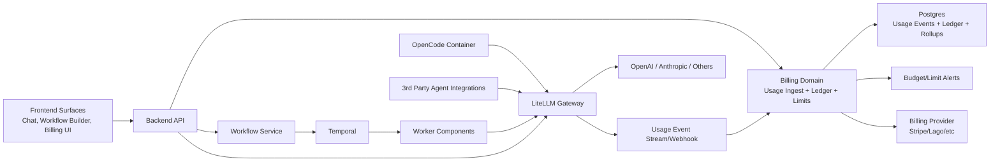
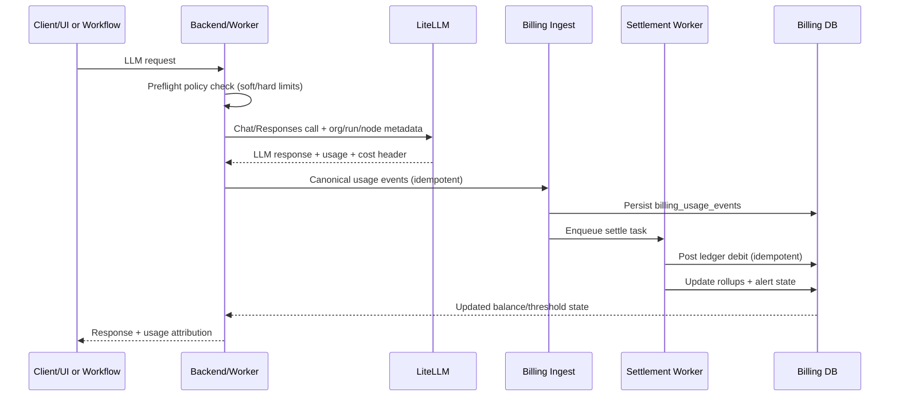

# ShipSec Studio Billing and Credits Architecture Plan

Status: Proposed architecture plan for implementation

Audience: Engineering, Platform, Product, and architecture review

Scope: End-to-end billing experience across primary chat agent, in-workflow agents, third-party agents, and workflow runs, with LiteLLM as centralized AI metering/gateway

## 1. Executive Summary

This plan defines a production-grade billing architecture for ShipSec Studio that:

- centralizes all LLM traffic through LiteLLM,
- tracks billable usage through immutable usage events and a credits ledger,
- supports tier entitlements (included credits) plus overage,
- provides organization-level billing UX and enforcement,
- keeps workflow-run economics visible from day one,
- is resilient to retries, partial failures, and provider/accounting drift.

The design intentionally separates:

- Usage telemetry (high-volume events)
- Entitlements and credit accounting (financial truth)
- Invoice/payment processing (external billing provider)

This separation prevents coupling platform runtime behavior to invoice lifecycle while preserving auditability.

## 2. Current State (Repo-Grounded)

### 2.1 Existing execution and metering primitives

- Workflow runs are persisted in `workflow_runs` with `organization_id`, trigger metadata, and timestamps.
- Agent trace events are persisted in `agent_trace_events` via Kafka ingest.
- `core.ai.agent` now emits a `data-usage` trace part containing model usage payloads.
- A new backend billing module exists with `GET /billing/usage` that currently computes:
  - monthly workflow run count from `workflow_runs`
  - monthly AI token totals from `agent_trace_events` (`data-usage` parts)
- Authentication and org scoping are enforced through `AuthContext` and guards.

### 2.2 Existing agent channels

- In-workflow AI agent (`core.ai.agent`) uses AI SDK providers directly (`createOpenAI`, `createGoogleGenerativeAI`) and MCP tool calls.
- OpenCode agent (`core.ai.opencode`) runs in Docker and supports provider env keys (OpenAI/OpenRouter/Anthropic/Groq/XAI/DeepSeek).
- MCP gateway exists and is run-scoped; tools are registered and invoked with trace visibility.
- There is currently no standalone first-class "primary chat agent" product surface implemented in frontend/backend routes.

### 2.3 Existing plan/tier primitive

- `organization_settings.subscription_tier` exists (`free`, `pro`, `enterprise`) and is currently used by analytics retention settings.

## 3. Target Product Experience

## 3.1 Billing UX outcomes

Customers should be able to answer, at any time:

- How many credits were included this cycle?
- How many credits were used, where, and by whom?
- What cost came from primary chat vs workflow agents vs third-party agent flows?
- What happens when we approach/exceed limits?
- What is projected end-of-cycle spend?

### 3.2 Core product surfaces

- Billing overview page: plan, cycle window, credits included, used, remaining, overage.
- Usage explorer: filterable ledger/events (channel, model, workflow, run, node, actor, cache read/write).
- Limits and alerts: spend thresholds, hard/soft caps, channel-level policy.
- In-context signals:
  - chat composer quota state
  - workflow run preflight estimate
  - run summary cost breakdown
  - failure reason when blocked by policy.

### 3.3 Launch policy defaults (recommended)

- Billing model: included monthly credits + overage.
- Enforcement scope at launch: AI usage enforced; workflow-run quota visible but not hard-blocked.
- Source of truth: LiteLLM metering events + ShipSec credits ledger.

## 4. Architecture Principles

- Single metering choke point for all LLM calls: LiteLLM.
- Immutable events + immutable ledger entries for auditability.
- Idempotent ingestion and posting to handle retries safely.
- Multi-tenant by default (`organization_id` required on all billable paths).
- Separation of concerns:
  - metering
  - entitlement/ledger
  - invoicing/payments.
- Graceful degradation: usage logging must never break core workflow execution.

## 5. High-Level Architecture



## 6. Metering Scope Matrix

| Channel                                           | Billing Unit                        | Meter Source                                               | Enforcement Point                        | Notes                                                 |
| ------------------------------------------------- | ----------------------------------- | ---------------------------------------------------------- | ---------------------------------------- | ----------------------------------------------------- |
| Primary chat agent (new surface)                  | input/output/cache tokens, requests | LiteLLM usage event                                        | chat request preflight + post-settlement | Requires explicit org+user attribution                |
| In-workflow `core.ai.agent`                       | input/output/cache tokens, requests | LiteLLM usage event (fallback trace usage while migrating) | before model call + async settlement     | Attach `runId`, `nodeRef`, `workflowId`               |
| OpenCode/Claude-code style nodes                  | same as above                       | LiteLLM usage event                                        | before launch + post-settlement          | Must route OpenCode provider through LiteLLM base URL |
| Third-party agent flows (MCP tools invoking LLMs) | same as above                       | LiteLLM usage event                                        | policy gate per org/agent key            | Require org-scoped virtual keys                       |
| Non-AI workflow execution                         | run count, optional compute minutes | `workflow_runs` (and worker timing)                        | visibility-only at launch                | Enable enforce later if desired                       |

## 7. Data Model (Decision Complete)

All tables in Postgres/Drizzle. Naming can follow existing snake_case conventions.

### 7.1 Billing account and plan mapping

1. `billing_accounts`

- `id` uuid pk
- `organization_id` varchar(191) unique not null
- `status` enum/string (`active`, `past_due`, `suspended`)
- `provider_customer_id` text nullable
- `provider_subscription_id` text nullable
- `current_plan_code` varchar(64) not null
- `billing_email` text nullable
- `created_at`, `updated_at`

2. `billing_plans`

- `code` varchar(64) pk (`free`, `pro`, `enterprise`, etc.)
- `name` text
- `monthly_base_price_cents` int
- `currency` varchar(8)
- `active` boolean

3. `billing_plan_entitlements`

- `id` uuid pk
- `plan_code` fk -> `billing_plans.code`
- `meter_key` varchar(64) (`ai_credits`, `workflow_runs`)
- `included_units` bigint
- `overage_price_micros` bigint nullable
- `reset_cadence` varchar(32) (`monthly`)
- unique `(plan_code, meter_key)`

### 7.2 Usage events and rollups

4. `billing_usage_events`

- `id` uuid pk
- `idempotency_key` varchar(191) unique not null
- `organization_id` varchar(191) not null
- `occurred_at` timestamptz not null
- `channel` varchar(64) not null (`primary_chat`, `workflow_agent`, `opencode`, `third_party_agent`)
- `meter_key` varchar(64) not null (`llm_tokens_input`, `llm_tokens_output`, `llm_tokens_cache_read`, `llm_tokens_cache_write`, `llm_requests`)
- `units` bigint not null
- `model` varchar(191) nullable
- `provider` varchar(64) nullable
- `workflow_id` uuid nullable
- `run_id` text nullable
- `node_ref` text nullable
- `agent_run_id` text nullable
- `actor_id` varchar(191) nullable
- `request_id` text nullable
- `raw_payload` jsonb nullable
- `cost_micros` bigint nullable
- indexes:
  - `(organization_id, occurred_at desc)`
  - `(organization_id, channel, occurred_at desc)`
  - `(organization_id, meter_key, occurred_at desc)`

5. `billing_usage_rollups_daily`

- `organization_id`, `day`, `channel`, `meter_key`, `model` composite unique
- `units_total` bigint
- `cost_micros_total` bigint
- Used for fast UI queries and forecasts.

### 7.3 Credits ledger (financial truth)

6. `billing_credit_wallets`

- `id` uuid pk
- `organization_id` unique not null
- `currency` varchar(8) default `usd`
- `created_at`, `updated_at`

7. `billing_credit_ledger_entries`

- `id` uuid pk
- `organization_id` not null
- `wallet_id` fk
- `entry_type` varchar(32) (`grant`, `debit`, `refund`, `adjustment`, `overage_invoice`)
- `units` bigint not null (positive for grants/refunds, negative for debits)
- `balance_after` bigint not null
- `reference_type` varchar(64) (`cycle_grant`, `usage_event`, `manual_adjustment`, `invoice`)
- `reference_id` varchar(191)
- `idempotency_key` varchar(191) unique not null
- `metadata` jsonb nullable
- `created_at` timestamptz not null
- indexes:
  - `(organization_id, created_at desc)`
  - `(organization_id, reference_type, reference_id)`

8. `billing_cycles`

- `id` uuid pk
- `organization_id` not null
- `cycle_start`, `cycle_end` timestamptz
- `plan_code` varchar(64)
- `ai_credits_included` bigint
- `workflow_runs_included` bigint
- `status` (`open`, `closed`, `invoiced`)
- unique `(organization_id, cycle_start, cycle_end)`

### 7.4 Budgets and enforcement policy

9. `billing_policies`

- `organization_id` unique
- `hard_limit_enabled` boolean
- `hard_limit_units` bigint nullable
- `soft_limit_thresholds` jsonb (example `[50,80,100]`)
- `channels_enabled` jsonb
- `updated_by`, `updated_at`

10. `billing_alert_events`

- alert firing history to avoid duplicate spam and provide audit trail.

## 8. API and Interface Plan

### 8.1 Public backend API

1. `GET /billing/overview`

- Returns plan, cycle window, included/used/remaining per meter, projected overage.

2. `GET /billing/usage`

- Existing endpoint evolves to include:
  - channel breakdown
  - cache token usage
  - model/provider breakdown
  - cost estimates.

3. `GET /billing/ledger`

- Cursor-paginated ledger entries with filters (`type`, `from`, `to`, `referenceType`).

4. `GET /billing/usage-events`

- Cursor-paginated raw usage events (admin only).

5. `PUT /billing/policies`

- Configure soft/hard limits and alert thresholds (admin only).

6. `GET /billing/alerts`

- Current and historical alerts.

7. `POST /billing/checkout-session` (if Stripe style hosted checkout)

### 8.2 Internal API

1. `POST /internal/billing/usage-events`

- Ingest normalized usage event from trusted internal services (LiteLLM webhook relay, worker fallback).
- Requires `x-internal-token`.
- Fully idempotent by `idempotency_key`.

2. `POST /internal/billing/settle-usage`

- Applies usage events to ledger entries and rollups (optional async worker path).

### 8.3 Auth and authorization

- Read endpoints: org member; detailed event/ledger/policy endpoints admin-only by default.
- Policy mutation: org admin only.
- API keys: add `billing.read` and `billing.write` permissions if machine-level access is needed.

## 9. LiteLLM Integration Plan

## 9.1 Deployment

Add LiteLLM as first-class service:

- Dev compose and prod compose service definitions.
- Config file from env + model map.
- Healthcheck and startup ordering.
- Optional Redis for LiteLLM cache.

## 9.2 Routing policy

All LLM calls must route via LiteLLM.

- Backend/worker components call LiteLLM endpoint only.
- Model string can remain provider-qualified (example `anthropic/claude-sonnet-4-20250514`) while transport is LiteLLM.
- No direct provider key usage in component code paths after migration (except controlled break-glass).

## 9.3 Metadata propagation for billing

Every LLM request must include metadata headers/fields:

- `x-shipsec-org-id`
- `x-shipsec-user-id` (when available)
- `x-shipsec-channel`
- `x-shipsec-workflow-id` (optional)
- `x-shipsec-run-id` (optional)
- `x-shipsec-node-ref` (optional)
- `x-shipsec-agent-run-id` (optional)
- `x-shipsec-request-id`

These become usage event dimensions for attribution.

## 9.4 Cache usage handling

Provider-side prompt cache metrics are accepted as source truth.

Expected normalized fields from LiteLLM/provider payloads:

- input tokens
- output tokens
- cache read tokens
- cache write/creation tokens

Billing engine stores all four categories separately, then applies plan pricing rules.

## 9.5 Usage ingestion path

Two valid ingestion options; choose one and keep the other as fallback:

1. LiteLLM webhook/callback -> backend internal ingest endpoint.
2. Poll LiteLLM spend/usage logs periodically and ingest incrementally.

Recommended: webhook/stream first, polling as reconciliation fallback.

## 10. Channel-by-Channel Implementation

### 10.1 Primary chat agent (new first-class surface)

This repo currently lacks a standalone primary chat route. Build as:

- Backend:
  - `ChatController` / `ChatService` routing through LiteLLM
  - streaming responses (SSE)
  - emits usage event with `channel=primary_chat`
- Frontend:
  - chat page/component
  - composer with remaining credits indicator
  - preflight warning when near hard limit.

### 10.2 In-workflow AI agent (`core.ai.agent`)

- Replace mixed provider transports with a LiteLLM-first client path.
- Keep provider/model contract for UX compatibility, but execution path always hits LiteLLM.
- Preserve current `data-usage` trace emission as fallback telemetry.
- Add request metadata tags from workflow context.

### 10.3 OpenCode / Claude-code style nodes (`core.ai.opencode`)

- Standardize OpenCode execution to use LiteLLM endpoint and org-scoped key.
- Ensure model strings support Anthropic through LiteLLM mapping.
- Capture usage from LiteLLM events; use OpenCode logs only for diagnostics.
- Maintain current MCP tooling flow unchanged except billing tags.

### 10.4 Third-party agent pathways

- For third-party agents/tools invoking LLMs, require LiteLLM virtual keys tied to org.
- Enforce deny-by-default for non-LiteLLM egress in managed flows where feasible.
- Track channel as `third_party_agent` and include source identifiers.

### 10.5 Workflow run metering

- Keep `workflow_runs` count as meter key (`workflow_runs`).
- Launch as visibility-only (not hard-gated).
- Prepare enforcement hook in workflow start path for later phase.

## 11. Credit Accounting and Enforcement

### 11.1 Ledger semantics

- Never store mutable counters as source truth.
- Balance = sum of ledger entries by org wallet.
- Every ledger write must be idempotent and reference usage/cycle origin.

### 11.2 Reservation and settlement

For LLM calls:

1. Preflight estimate (optional small reserve) based on max tokens/model policy.
2. Execute call via LiteLLM.
3. Ingest actual usage event.
4. Post final debit ledger entry using actual units/cost.
5. Release unused reserve or post adjustment.

If reserve model is deferred for launch, enforce post-facto soft limits and hard-limit from current balance at request start.

### 11.3 Limit behavior

- Soft thresholds: fire alerts at configurable percentages.
- Hard limit:
  - if enabled and projected/actual debit exceeds balance, reject with deterministic error code.
- Error contract examples:
  - `BILLING_HARD_LIMIT_REACHED`
  - `BILLING_PLAN_RESTRICTED_MODEL`
  - `BILLING_CHANNEL_DISABLED`

## 12. Pricing and Entitlements

### 12.1 Meter keys

- `ai_credits` (derived from weighted token categories)
- `workflow_runs`

Optional future meter keys:

- `agent_tool_calls`
- `opencode_runtime_minutes`
- `artifact_storage_gb_month`

### 12.2 Credit conversion

Implement explicit versioned pricing function, for example:

- `credits = ceil((input*w_in + output*w_out + cache_read*w_cr + cache_write*w_cw) / unit_divisor)`

Store `pricing_version` with each debit for reproducibility.

### 12.3 Plan migration

- Plan change creates a new active cycle or proration record depending on policy.
- Keep historical cycles immutable.

## 13. Reconciliation and Financial Integrity

Nightly job:

1. Pull LiteLLM usage window.
2. Compare to ingested `billing_usage_events`.
3. Detect missing/duplicate/drifted costs.
4. Auto-heal safe discrepancies; open alert for manual review above threshold.

Drift policies:

- small drift auto-adjust with `adjustment` ledger entry
- large drift requires operator approval.

## 14. Frontend Billing Experience Blueprint

### 14.1 Pages and navigation

- Add `/settings/billing` section with tabs:
  - Overview
  - Usage
  - Ledger
  - Limits and Alerts
  - Plan and Invoices

### 14.2 In-context components

- Top bar usage chip (credits remaining + status color).
- Chat composer meter with estimated cost per send.
- Workflow run dialog estimate panel:
  - "Estimated AI credit range"
  - policy warnings.
- Run detail cost panel:
  - per node/model/tool cost and token metrics.

### 14.3 UX states

- healthy (normal)
- warning (threshold crossed)
- blocked (hard limit)
- degraded metering (data delayed; show banner).

## 15. Observability, Alerting, and Ops

Expose dashboards and alerts for:

- ingest lag (LiteLLM -> billing)
- event dedupe collisions
- ledger posting failures
- reconciliation drift
- blocked call rate by org/channel/model
- cost spikes and anomaly detection.

Use existing telemetry stack (PostHog, logs, Kafka, DB) plus billing-specific metrics.

## 16. Security and Compliance

- Do not store raw prompts/responses in billing tables; only metadata and token/cost dimensions.
- Encrypt secrets/keys (existing encryption patterns).
- Principle of least privilege for billing admin operations.
- Full audit log on policy and plan changes.
- Support data retention controls for detailed usage event payloads.

## 17. Rollout Plan (Phased)

### Phase 0: Foundation hardening

- Keep current `/billing/usage` in place.
- Introduce canonical tables (`billing_usage_events`, `billing_credit_ledger_entries`, cycles).
- Add idempotent ingest endpoint and posting worker.
- Acceptance: usage event can be ingested and appears in ledger safely under retries.

### Phase 1: LiteLLM centralization

- Deploy LiteLLM service in dev/prod environments.
- Route `core.ai.agent`, `llm-generate-text`, and OpenCode via LiteLLM.
- Add metadata propagation for org/run/node attribution.
- Acceptance: zero direct provider calls on supported channels in standard mode.

### Phase 2: UX and policy controls

- Ship Billing Overview/Usage/Ledger pages.
- Ship soft limit alerts and hard-limit enforcement toggles.
- Add topbar/chat/workflow warnings.
- Acceptance: admin can configure limits and see deterministic enforcement behavior.

### Phase 3: Payments and invoicing

- Integrate billing provider (Stripe/Lago) for overage + invoices.
- Sync plan state and cycle close behavior.
- Acceptance: invoice line items reconcile with ledger totals.

### Phase 4: Reconciliation and governance

- Nightly reconcile pipeline and discrepancy automation.
- Add anomaly alerts and operator tooling.
- Acceptance: drift below agreed threshold with auditable correction workflow.

## 18. Detailed Test Strategy

### 18.1 Unit tests

- pricing conversion by pricing version
- ledger posting idempotency
- hard-limit decision engine
- cycle rollover grant logic
- event parser for LiteLLM usage payload variations.

### 18.2 Integration tests

- LiteLLM usage event ingest -> ledger posting -> API read path
- workflow agent call with metadata attribution
- OpenCode path attribution and usage capture
- policy mutation and authorization checks.

### 18.3 E2E tests

- chat flow consumes credits and updates UI indicators
- workflow run with AI nodes shows cost breakdown
- soft threshold alert visible
- hard-limit blocks subsequent AI call with expected error code
- org isolation: no cross-org billing visibility or side effects.

## 19. Migration and Backward Compatibility

- Keep current `GET /billing/usage` contract backward compatible; extend fields additively.
- Preserve trace-based fallback metering during LiteLLM cutover window.
- Introduce feature flag:
  - `BILLING_LITELLM_METERING_ENABLED`
  - `BILLING_HARD_LIMITS_ENABLED`
  - `BILLING_CHAT_CHANNEL_ENABLED`

## 20. Risks and Mitigations

1. Partial LiteLLM adoption

- Risk: direct provider paths bypass billing.
- Mitigation: centralized client wrappers + CI policy checks for direct provider SDK usage.

2. Event duplication or loss

- Risk: incorrect debits.
- Mitigation: strict idempotency keys + reconciliation job + dead-letter handling.

3. Cache metrics inconsistency by provider/model

- Risk: inaccurate credit conversion.
- Mitigation: normalize unknown fields to zero, versioned pricing, and provider-specific adapters.

4. Runtime latency overhead

- Risk: added billing checks slow requests.
- Mitigation: fast preflight checks in memory/cache; async settlement pipeline.

5. Payment provider coupling

- Risk: billing outages affect runtime.
- Mitigation: runtime enforcement uses internal ledger only; invoice sync is asynchronous.

## 21. Work Breakdown by Repository Area

### Backend

- Expand billing domain into full event + ledger + policy system.
- Add public and internal billing APIs.
- Add posting/reconciliation workers.
- Add auth permissions for billing endpoints.

### Worker

- Route all LLM-capable components via LiteLLM-compatible transport.
- Enrich requests with billing attribution metadata.
- Keep trace usage fallback.

### Frontend

- Billing settings surfaces and in-context usage indicators.
- Hard-limit and warning UX handling for chat/workflow actions.

### Infra

- Add LiteLLM container/config in compose and production stack.
- Add secrets/config management for LiteLLM master and virtual keys.
- Add monitoring dashboards and alerts.

### Docs

- New architecture doc for billing and metering lifecycle.
- Operator runbook for reconciliation and incident response.
- Developer guide for adding new billable channels.

## 22. Explicit Assumptions

- Organization is the primary billing entity.
- Included credits + overage is the commercial model.
- LiteLLM is accepted as AI metering/control plane.
- Primary chat agent will be added as a new product surface (not currently present in repo).
- Workflow-run quota enforcement is deferred; visibility ships first.

## 23. Immediate Next Step Implementation Blueprint

1. Finalize canonical billing tables and migrations.
2. Implement idempotent usage ingest endpoint + posting service.
3. Add LiteLLM service and route `core.ai.agent` + `llm-generate-text` through it.
4. Add attribution headers/metadata for all AI requests.
5. Ship `/billing/overview` + `/billing/ledger` APIs.
6. Build `/settings/billing` overview UI.
7. Add soft-limit alerts and error contract for hard-limit.
8. Add reconciliation job and runbook.

## 24. No-Gap Event Contract (Canonical)

All AI and workflow billing must flow through a single canonical event contract before entering ledger settlement.

```json
{
  "idempotencyKey": "string",
  "occurredAt": "2026-02-11T12:00:00.000Z",
  "organizationId": "org_123",
  "channel": "primary_chat | workflow_agent | opencode | third_party_agent | workflow_runtime",
  "meterKey": "llm_tokens_input | llm_tokens_output | llm_tokens_cache_read | llm_tokens_cache_write | llm_requests | workflow_runs",
  "units": 123,
  "model": "anthropic/claude-sonnet-4-5",
  "provider": "anthropic",
  "workflowId": "uuid|null",
  "runId": "string|null",
  "nodeRef": "string|null",
  "agentRunId": "string|null",
  "actorId": "string|null",
  "requestId": "string|null",
  "traceId": "string|null",
  "costMicros": 12345,
  "pricingVersion": "v1",
  "rawPayload": {}
}
```

Idempotency key formula (decision):

- Primary chat: `orgId:channel:requestId:meterKey`
- Workflow agent/opencode: `orgId:runId:nodeRef:requestId:meterKey`
- Third-party routed via LiteLLM virtual key: `orgId:virtualKeyId:requestId:meterKey`
- Workflow runtime counters: `orgId:runId:workflow_runs`

Rules:

- Reject event if `organizationId` missing.
- Reject event if `units < 0` for usage events.
- Store raw payload for audit/debug with size cap (for example 16 KB) and PII/secret redaction.
- Upsert semantics by `idempotencyKey`; never duplicate billable effect.

## 25. End-to-End Settlement Sequence (Decision)



Decision detail:

- Preflight is synchronous and cheap (cached balance + policy snapshot).
- Ingest/settlement are asynchronous but near-real-time.
- If settlement is delayed, system still serves response and marks usage as `pending_settlement`.
- Hard-limit enforcement at request start; if projected cost uncertain, use conservative model ceiling.

## 26. Build vs Buy (Explicit Decision Record)

### 26.1 In-house full metering/billing system complexity

- Complexity: high (data correctness + reconciliation + dunning + tax/invoice edge cases).
- Engineering estimate for robust in-house stack:
  - Metering + ledger + limits + reconciliation: 8-12 weeks
  - Invoicing/payment lifecycle + tax + credits lifecycle: additional 6-10 weeks
  - Ongoing operations/compliance burden: permanent.

### 26.2 Recommended architecture

- Build in-house:
  - usage normalization
  - credit ledger
  - runtime enforcement
  - product-facing billing UX
- Buy/bridge for invoicing:
  - Stripe/Lago/Metronome/Orb style invoice rails
  - payment collection, dunning, tax and accounting workflows.

### 26.3 Why LiteLLM is the right control plane

- One gateway path for OpenAI + Anthropic + others.
- Unified spend tracking and budgets on virtual keys/users/teams.
- Metadata/tagging hooks for attribution.
- Supports custom pricing keys including cache token costs.

Inference from sources:

- LiteLLM spend/cost tracking is strong for runtime control; finance-grade reconciliation still benefits from your own immutable ledger.

## 27. Claude/Anthropic and Cache Billing Semantics

Billing decision:

- Treat provider-reported usage as primary usage truth at request-time.
- For Anthropic via LiteLLM, preserve:
  - `cache_read_input_tokens`
  - `cache_creation_input_tokens`
  - `input_tokens`
  - `output_tokens`
- Credit conversion uses separate weights/rates for cache read vs cache write.

Important distinction:

- Provider prompt caching (OpenAI/Anthropic): provider computes cache hits/writes.
- LiteLLM proxy response cache (Redis/local): gateway-level response reuse (different mechanism).
- We track both dimensions, but monetary debits for provider usage come from provider usage fields.

## 28. Concrete LiteLLM Container Plan for ShipSec

Service addition (dev/prod):

- Container image: `docker.litellm.ai/berriai/litellm:<pinned-version-or-digest>`
- Port: `4000`
- Persistent DB: Postgres (required for proxy budgets/spend logs/features)
- Optional cache: Redis for gateway response caching

Baseline runtime config:

- `LITELLM_MASTER_KEY`
- `LITELLM_SALT_KEY`
- provider keys (`OPENAI_API_KEY`, `ANTHROPIC_API_KEY`, etc.)
- config.yaml model aliases for approved models only

Operational requirements:

- Pin image by version or digest (no floating tag in production).
- Health checks + readiness before worker/backend dependency starts.
- Centralized logs and metrics export to existing observability stack.
- Rotate master/salt/provider keys on schedule with runbook.

## 29. Detailed Acceptance Gates (Architecture Review Ready)

Gate A: Correctness

- Same usage event replayed 100 times creates one financial effect.
- Ledger balance always equals sum of immutable entries.
- Cross-org leakage tests prove strict org isolation.

Gate B: Runtime safety

- Billing subsystem outage does not break workflow execution path.
- Hard-limit block emits deterministic error contract and full audit record.

Gate C: Financial integrity

- Nightly reconciliation drift below threshold (for example <0.5% of daily cost).
- Manual adjustments require role-based approval and emit immutable audit entries.

Gate D: Product UX

- Org admin can see included/used/remaining and top cost drivers.
- Run-level cost view available for workflow runs with AI nodes.
- Warning and blocked states are visible and actionable.

## 30. External Research Notes and References

Primary technical references used for decisions:

- LiteLLM AI Gateway overview and capabilities: https://docs.litellm.ai/docs/simple_proxy
- LiteLLM budgets/rate limits (users/teams/keys): https://docs.litellm.ai/docs/proxy/users
- LiteLLM spend tracking and logs (`x-litellm-response-cost`, `/spend/logs`): https://docs.litellm.ai/docs/proxy/cost_tracking
- LiteLLM request tags for attribution: https://docs.litellm.ai/docs/proxy/request_tags
- LiteLLM custom pricing (including cache cost keys): https://docs.litellm.ai/docs/proxy/custom_pricing
- LiteLLM prompt caching normalization details: https://docs.litellm.ai/docs/completion/prompt_caching
- LiteLLM deployment (Docker/Compose/Helm) and production notes: https://docs.litellm.ai/docs/proxy/deploy
- Anthropic prompt caching usage fields (`cache_creation_input_tokens`, `cache_read_input_tokens`): https://docs.anthropic.com/en/docs/build-with-claude/prompt-caching
- Anthropic Usage and Cost Admin API (for reconciliation): https://docs.anthropic.com/en/api/usage-cost-api
- OpenAI prompt caching behavior and `cached_tokens`: https://platform.openai.com/docs/guides/prompt-caching
- OpenAI Usage vs Costs reconciliation guidance: https://platform.openai.com/docs/api-reference/usage/cost
- Stripe usage-based billing primitives (meters/events/idempotency): https://docs.stripe.com/billing/subscriptions/usage-based/how-it-works
- Lago event ingestion and idempotency (`transaction_id`): https://docs.getlago.com/guide/events/ingesting-usage

Supplementary industry-pattern references:

- Metronome on usage events + billable metrics separation: https://docs.metronome.com/how-metronome-works/
- Orb ingestion idempotency patterns: https://docs.withorb.com/api-reference/event/ingest-events
