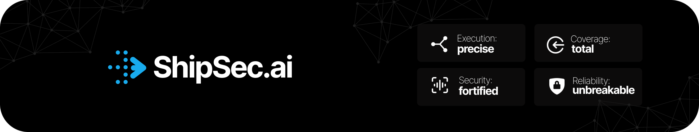

<div align="center">
  
</div>

<p align="center">
  
  <a href="https://github.com/ShipSecAI/studio/tree/main/LICENSE"></a>
  <a href="https://discord.gg/fmMA4BtNXC"></a>
</p>

# ShipSec Studio

**The harness for agent-native security workflow orchestration.**

ShipSec Studio is an open-source platform for building, running, observing, and governing security workflows that combine agents, MCP tools, scanners, APIs, and human approvals in one durable execution system.

This repository is the **public product tree**:

- application code
- shared packages
- image build surface
- minimal CE runtime compose files for local and single-node validation
- CI and release automation for those images

It does **not** ship the private deployment overlays, Helm charts, or hosted environment setup.

## Why Studio

- **Agent-native by design**: combine AI agents, MCP tools, and traditional security components inside real workflows.
- **Durable execution**: retries, resumability, schedules, and long-running waits are backed by Temporal.
- **Human-in-the-loop controls**: approvals, forms, and manual branching are part of the runtime model.
- **Full run visibility**: logs, terminal output, events, artifacts, and replayable execution history.
- **Reusable security automation**: workflows, templates, and report templates for common security operations.

## Core Primitives

- **Workflows**: visual graphs that compile into executable security automations
- **Agents**: tool-using AI steps, chat sessions, and skill-enabled runs
- **Tools**: MCP servers, scanners, HTTP integrations, and runtime credential resolvers
- **Human steps**: approvals, forms, and manual decision points
- **Observability**: traces, terminal streams, logs, artifacts, and audit records

## What This Repo Publishes

The public repo is responsible for the Studio images, for example:

- `ghcr.io/shipsecai/studio-backend:latest`
- `ghcr.io/shipsecai/studio-worker:latest`
- `ghcr.io/shipsecai/studio-frontend:latest`

Self-hosters can compose these images into their own deployment model using the infrastructure they prefer.

## Development

For source-level development:

```bash
just init
just infra up
just dev
```

For the full CE Docker stack:

```bash
just ce up
```

## OSS vs ShipSec Cloud

The public repo supports the core product directly:

- self-hosted workflows
- direct provider configuration
- local or external auth
- AI via model/base URL/API key
- user-managed integrations and credentials

ShipSec Cloud is the managed hosted offering. Public docs mention it at the product level, not the implementation level.

## Learn More

- [Introduction](docs/index.mdx)
- [Quickstart](docs/quickstart.mdx)
- [Installation](docs/installation.mdx)
- [Self-Hosting](docs/self-hosting.mdx)
- [Product / Workflows](docs/product/workflows.mdx)
- [Product / Agents & Tools](docs/product/agents-and-tools.mdx)
- [Integrations](docs/integrations/index.mdx)
- [Deployment Model](docs/deployment-model.mdx)
- [OSS vs ShipSec Cloud](docs/oss-vs-cloud.mdx)
- [Architecture](docs/architecture.mdx)

## Community

- Discord: https://discord.gg/fmMA4BtNXC
- Discussions: https://github.com/ShipSecAI/studio/discussions
- Docs: https://docs.shipsec.ai
