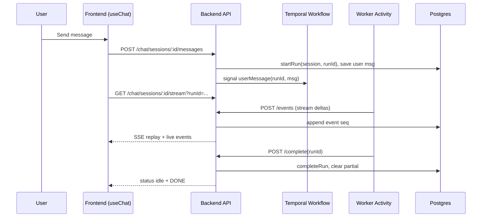
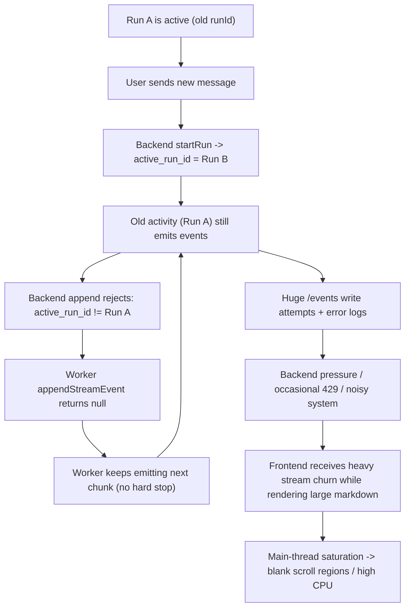

# Chat Streaming + Backend Hammering Investigation (Instance 5)

Date: 2026-03-04  
Workspace: `studio-wt5`  
Active instance: `5`

## Executive Summary

Two independent-but-interacting issues were present:

1. Frontend render starvation during large streaming markdown
2. Backend hammering from a stale Temporal run continuing to emit events after `active_run_id` switched

The second issue amplified the first by increasing event pressure and error churn.  
Current status: the runaway workflow is now completed, hammering has stopped, but frontend streaming performance is still a bottleneck for very large responses.

## What Was Happening

### User-visible symptoms

- Chat tab spikes to very high CPU during long responses
- Scrolling up during streaming can show white/blank areas for seconds
- UI becomes responsive again after stream completion/refresh
- Backend showed bursts of 429 and heavy chat event traffic

### Why scroll is fast after full content is available

Once streaming stops, the text is stable:

- no per-delta React message list updates
- no repeated full markdown re-parsing on every new chunk
- browser can cache/layout once and scroll cheaply

During streaming, those expensive operations are continuous, so scroll paint misses frame deadlines.

## Hard Evidence Collected

### Temporal and DB snapshot (session `8b0594a3-7a13-4258-bf9a-cf8bb2e477b3`)

- Workflow `chat-8b0594a3-7a13-4258-bf9a-cf8bb2e477b3`:
  - started: `2026-03-03T13:59:35.935574Z`
  - completed: `2026-03-03T14:59:52.370456Z`
  - status: `WORKFLOW_EXECUTION_STATUS_COMPLETED`
- `chat_sessions` row:
  - `processing_status=idle`
  - `active_run_id=NULL`
  - `next_event_seq=13`
  - `updated_at=2026-03-03 14:29:47.011+00`
- `chat_stream_events` grouped by run:
  - `bd703d0c-a3a4-458d-a265-00c2b131363b` -> `10135` events (`seq 1..10135`)
  - `e2082935-1983-43f4-b586-02ae709fe16c` -> `12` events (`seq 1..12`)

### Log volume for same session

- `POST /api/v1/chat/sessions/<session>/events` in backend out log: **73,786**
- `Unable to append event: session ... is not running bd703...` in backend error log: **124,255**
- Peak event POST density: up to **101 lines/sec** (top buckets around `10:00 PM` to `10:29 PM`, 2026-03-03, log local time)

### Message history confirmation

The message `"tell me a small joke. very small"` is persisted in `chat_messages` for that session, followed by a final assistant joke response.  
Token usage is **not persisted** in `chat_messages` schema (no `total_tokens` column), so exact per-message token totals are currently unavailable from DB.

## Root Cause Analysis

### 1) Frontend render bottleneck (streaming phase)

Most probable root cause: full markdown re-parse + large tree diff on high-frequency text deltas.

Flow:

1. `useChat` receives many `text-delta` chunks
2. Each chunk updates message state (new array)
3. Message list reconciliation runs repeatedly
4. Streamdown re-renders/re-parses growing markdown content
5. Main thread spends too much time in JS/layout/paint, causing blank scroll regions until work drains

Contributing factors found:

- very large responses (tool-heavy + long markdown)
- expensive markdown/plugins/code rendering during stream
- previous `content-visibility` usage on assistant content caused deferred paints (partially reverted)
- throttling exists but still re-parses large docs several times/sec

### Relevant code paths

- `frontend/src/pages/ChatInterface.tsx`
  - `ThrottledMessageResponse` (`~76-121`)
  - memoized `ChatMessageItem` and `ToolPartRenderer` (`~123-285`)
  - passive status polling and stream attach (`~624-816`)
- `frontend/src/lib/durable-chat-transport.ts`
  - delta coalescing flush every `120ms` (`~131-177`)
- `frontend/src/components/ai-elements/message.tsx`
  - `MessageResponse` wraps `Streamdown` (`~272-285`)

### 2) Stale-run hammer loop (backend/worker)

Most probable root cause: stale activity continues emitting events for old `runId` after session switches to new `active_run_id`, and worker does not stop on append rejection.

Mechanics:

1. New user message triggers `startRun(sessionId, newRunId)` in backend
2. Session `active_run_id` changes immediately
3. Older activity still emits events tagged with old run (`bd703...`)
4. Backend append enforces active-run match and rejects old run appends
5. Worker `appendStreamEvent` returns `null` on non-OK but caller keeps emitting/publishing
6. Loop continues at high frequency, hammering backend/logs

### Relevant code paths

- Backend sets active run:
  - `backend/src/chat/chat.service.ts` `sendMessage()` (`~289-313`)
  - `backend/src/chat/chat-session.repository.ts` `startRun()` (`~143-153`)
- Backend enforces run match:
  - `backend/src/chat/chat-stream-event.repository.ts` `append()` (`~15-39`)
- Worker continues on append failure:
  - `worker/src/temporal/activities/chat-agent.activities.ts`
    - `appendStreamEvent()` returns `null` if `!res.ok` (`~122-144`)
    - `emitStreamEvent()` still publishes with optional seq (`~147-161`)
    - stream loop emits every chunk (`~732+`)

### 3) 429s and extra noise

Two distinct sources were seen:

- Chat stream connection limits (`/stream` limits concurrent per-session streams in controller)
- Separate Kafka consumer timeout/restart churn (not the direct chat root cause, but noise/load)

Relevant controller limits:

- `backend/src/chat/chat.controller.ts`
  - `/stream` limit and active stream cap (`~116-147`)
  - `/events` read API throttled, but internal append endpoint is `@SkipThrottle()` (`~149-182`)

## Frontend Fixes Already Applied

From current working tree:

- memoization of chat message and tool part renderers
- text delta coalescing in transport (`120ms`)
- throttled markdown render during streaming (`120ms`)
- stuck `submitted/streaming` state cleanup when backend is idle
- removed deferred paint from code blocks
- avoid `content-visibility` on assistant messages

Net: tool-call phase improved significantly, but very large markdown streaming can still saturate CPU.

## Why White Space Appears During Scroll (Most Probable)

Not a data-loss issue; it is paint starvation:

- browser has layout regions but cannot paint in time while main thread is busy parsing/reconciling large streaming markdown
- scrolling demands new paint immediately; heavy JS/render work delays it
- when streaming pauses or finishes, paint catches up and content appears

This matches observed behavior: after stream completion, same content scrolls fast.

## Complete Fix Options

### A. Frontend rendering strategies

1. Stream plain text while streaming; render full markdown only on completion
   - best immediate CPU win
   - tradeoff: reduced formatting during stream

2. Dual-mode markdown
   - lightweight renderer/plugins during stream
   - full Streamdown + code highlighting after finish

3. Incremental chunked rendering
   - split response into append-only blocks and parse only new blocks
   - avoids full-document re-parse each delta
   - highest implementation complexity

4. Disable expensive plugins/highlighting during stream
   - postpone code highlighting/mermaid/math until idle/final state

5. Adaptive throttle
   - dynamically increase throttle interval with document size
   - partial mitigation, not a full cure for huge outputs

6. Virtualize long assistant outputs
   - render visible markdown segments only
   - complex with markdown semantics and code block boundaries

### B. Worker/backend protections (must-have)

1. Stop stale run emission on append mismatch
   - if append returns run-mismatch (409/explicit code), activity should terminate that run path immediately

2. Add circuit breaker/backoff on repeated append failures
   - prevent tight failure loops hammering backend

3. Return structured error for run mismatch from append endpoint
   - not generic `null`; include reason to allow deterministic worker handling

4. Add per-session internal write rate guard
   - protect backend from internal storms even when worker misbehaves

5. Improve run handoff semantics
   - ensure old run activity is cancelled/ignored once new run is active

### C. Observability and profiling

1. Add client perf marks around markdown render commit duration
2. Add counters: append success/failure by reason, stale-run reject count, events/sec by session
3. Capture one Chrome DevTools profile on heavy stream after fixes to verify top CPU consumers

## Recommended Execution Order

1. Implement stale-run hard-stop first (worker + backend contract)
2. Add circuit breaker/backoff for append failures
3. Switch to plain-text streaming mode for large responses (or all streaming)
4. Re-profile CPU/memory under same stress prompt
5. If needed, move to incremental/chunked markdown rendering

## Visual Representation

### Normal Chat Flow

### Failure Loop (Observed)

## Notes

- No synthetic slow-load logic was found in chat path; only intentional throttles/coalescing are present (both `120ms`) to reduce render pressure.
- Kafka timeout/restart warnings are present in backend logs and should be tracked, but they are separate from the core stale-run chat loop root cause.
