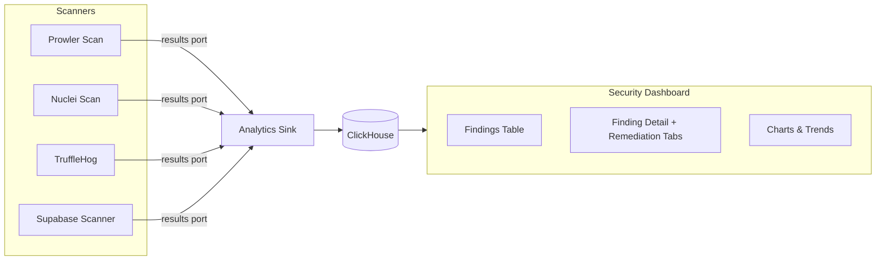

ShipSec Studio includes a workflow analytics system that indexes security findings into ClickHouse. This enables real-time dashboards, historical trend analysis, and alerting on security data.

---

## Overview

The analytics system consists of:

1. **Analytics Sink component** - Indexes workflow output data into ClickHouse
2. **Results output port** - Structured findings from security scanners
3. **ClickHouse storage** - Columnar database for querying and visualization
4. **View Analytics button** - Quick access to filtered dashboards

---

## Architecture



Each scanner outputs findings through its `results` port, which connects to the Analytics Sink. The sink indexes each finding as a separate document with workflow metadata.

---

## Document Structure

Indexed documents follow this structure:

```json
{
  "check_id": "DB_RLS_DISABLED",
  "severity": "CRITICAL",
  "title": "RLS Disabled on Table: users",
  "resource": "public.users",
  "metadata": "{\"schema\":\"public\",\"table\":\"users\"}",
  "scanner": "supabase-scanner",
  "asset_key": "abcdefghij1234567890",
  "finding_hash": "a1b2c3d4e5f67890",
  "shipsec": {
    "organization_id": "org_123",
    "run_id": "shipsec-run-xxx",
    "workflow_id": "d1d33161-929f-4af4-9a64-xxx",
    "workflow_name": "Supabase Security Audit",
    "component_id": "core.analytics.sink",
    "node_ref": "analytics-sink-1"
  },
  "@timestamp": "2025-01-21T10:30:00.000Z"
}
```

### Field Categories

| Category | Fields | Description |
|----------|--------|-------------|
| Finding data | `check_id`, `severity`, `title`, etc. | Scanner-specific fields at root level |
| Asset tracking | `scanner`, `asset_key`, `finding_hash` | Required fields for analytics |
| Workflow context | `shipsec.*` | Automatic metadata from the workflow |
| Timestamp | `@timestamp` | Indexing timestamp |

<Note>
  Nested objects in findings are automatically serialized to JSON strings to prevent field explosion.
</Note>

---

## `shipsec` context fields

The Analytics Sink automatically adds workflow context under the `shipsec` namespace:

| Field | Description |
|-------|-------------|
| `organization_id` | Organization that owns the workflow |
| `run_id` | Unique identifier for this workflow execution |
| `workflow_id` | ID of the workflow definition |
| `workflow_name` | Human-readable workflow name |
| `component_id` | Component type (always `core.analytics.sink`) |
| `node_ref` | Node reference in the workflow graph |
| `asset_key` | Auto-detected or specified asset identifier |

---

## Finding Hash for Deduplication

The `finding_hash` is a stable 16-character identifier that enables tracking findings across workflow runs.

### Purpose

- **New vs recurring**: Determine if a finding appeared before
- **First-seen / last-seen**: Track when findings were first and last detected
- **Resolution tracking**: Findings that stop appearing may be resolved
- **Deduplication**: Remove duplicates in dashboards across runs

### Generation

Each scanner generates the hash from key identifying fields:

| Scanner | Hash Fields |
|---------|-------------|
| Prowler | `findingId + resourceId/accountId + title` |
| Nuclei | `templateId + host + matchedAt` |
| TruffleHog | `DetectorType + Redacted + filePath` |
| Supabase Scanner | `check_id + projectRef + resource` |

Fields are normalized (lowercase, trimmed) and hashed with SHA-256, truncated to 16 hex characters.

---

## Querying Data

### Basic Queries (KQL)

```
# Find all findings for an asset
asset_key: "api.example.com"

# Filter by severity
severity: "CRITICAL" OR severity: "HIGH"

# Filter by scanner
scanner: "nuclei"

# All findings from a specific workflow run
shipsec.run_id: "shipsec-run-abc123"

# Filter by organization
shipsec.organization_id: "org_123"

# Filter by workflow
shipsec.workflow_id: "d1d33161-929f-4af4-9a64-xxx"
```

### Tracking Findings Over Time

```
# Track a specific finding across runs
finding_hash: "a1b2c3d4e5f67890"

# Find recurring findings (multiple runs)
# Use aggregation: group by finding_hash, count occurrences
```

### Common Aggregations

| Aggregation | Use Case |
|-------------|----------|
| `terms` on `severity` | Count findings by severity |
| `terms` on `scanner` | Count findings by scanner |
| `terms` on `asset_key` | Most vulnerable assets |
| `date_histogram` on `@timestamp` | Findings over time |
| `cardinality` on `finding_hash` | Unique findings count |

---

## Setting Up ClickHouse

### Environment Variables

Set these in your `worker/.env`:

```bash
CLICKHOUSE_URL=http://localhost:8123
CLICKHOUSE_USER=default
CLICKHOUSE_PASSWORD=
```

### Docker Compose

Provide a reachable ClickHouse instance for local or self-hosted analytics development.

---

## Prowler Check Metadata

Prowler findings include basic recommendation text and a URL, but richer remediation guidance (CLI commands, Terraform, CloudFormation, manual steps) is not included in the ASFF output. This data is extracted offline and served as a static asset.

### Endpoint

`GET /api/v1/analytics/prowler-checks-metadata`

Returns a JSON object keyed by Prowler CheckID:

```json
{
  "s3_bucket_server_side_encryption_enabled": {
    "checkTitle": "S3 Bucket has Server Side Encryption Enabled",
    "recommendation": "Enable server-side encryption...",
    "recommendationUrl": "https://hub.prowler.com/check/...",
    "cli": "aws s3api put-bucket-encryption ...",
    "nativeIaC": "Resources:\n  S3Bucket:\n    Type: AWS::S3::Bucket...",
    "terraform": "resource \"aws_s3_bucket_server_side_encryption_configuration\" ...",
    "other": "1. Open the S3 Console..."
  }
}
```

**Caching:** 30-day `Cache-Control` header. The frontend fetches once per session with `staleTime: Infinity`.

**Updating:** Run `bun scripts/generate-prowler-metadata.ts` when the Prowler Docker image is updated, then commit the resulting `backend/src/assets/prowler-checks.json`.

### Frontend Integration

The `FindingDetailSheet` component uses `useProwlerChecksMetadata()` to fetch the metadata map and matches Prowler findings by title (`checkTitle`) to display a tabbed remediation interface with syntax-highlighted code blocks.

---

## Analytics API Limits

The analytics query API enforces sane bounds to protect ClickHouse:

- `size` must be a non-negative integer and is capped at **1000**
- `from` must be a non-negative integer and is capped at **10000**

Requests above these limits return `400 Bad Request`.

## Analytics Settings Updates

The analytics settings API supports partial updates:

- `analyticsRetentionDays` is optional

Omit fields you don’t want to change. The backend validates retention days only when provided.

In OSS, the analytics settings surface uses the public single-tenant retention ceiling.
When the private overlay is present, the retention cap can be derived from the active billing plan instead.

---

## Using Analytics Sink

### Basic Workflow

1. Add a security scanner to your workflow (Nuclei, TruffleHog, etc.)
2. Add an Analytics Sink component
3. Connect the scanner's `results` port to the Analytics Sink's `data` input
4. Run the workflow

### Component Parameters

| Parameter | Description |
|-----------|-------------|
| **Asset Key Field** | Field to use as asset identifier. Auto-detect checks: asset_key > host > domain > subdomain > url > ip > asset > target |
| **Custom Field Name** | Custom field when Asset Key Field is "custom" |
| **Fail on Error** | When enabled, workflow stops if indexing fails. Default: fire-and-forget. |

### Fire-and-Forget Mode

By default, Analytics Sink operates in fire-and-forget mode:
- Indexing errors are logged but don't stop the workflow
- Useful for non-critical analytics that shouldn't block security scans
- Enable "Fail on Error" for strict indexing requirements

---

## View Analytics Button

The workflow builder includes a "View Analytics" button that opens the analytics view with pre-filtered data:

- **When a run is selected**: Filters by `shipsec.run_id`
- **When no run is selected**: Filters by `shipsec.workflow_id`
- **Time range**: Last 7 days

---

## Table Structure

Findings are written to the `security_findings` table in ClickHouse, partitioned by `toYYYYMM(timestamp)`. The `security_findings_latest` table (ReplacingMergeTree) provides deduplicated latest state per `finding_hash`, automatically populated by a materialized view.

---

## Building Dashboards

### Recommended Visualizations

| Visualization | Description |
|---------------|-------------|
| **Findings Over Time** | Line chart with `@timestamp` on X-axis, count on Y-axis |
| **Severity Distribution** | Pie chart with `terms` on `severity` |
| **Top Vulnerable Assets** | Bar chart with `terms` on `asset_key` |
| **Findings by Scanner** | Bar chart with `terms` on `scanner` |
| **New vs Recurring** | Use `finding_hash` cardinality vs total count |

### Alert Examples

| Alert | Query |
|-------|-------|
| Critical finding detected | `severity: "CRITICAL"` |
| New secrets exposed | `scanner: "trufflehog"` |
| RLS disabled | `check_id: "DB_RLS_DISABLED"` |

---

## Troubleshooting

### Data not appearing in ClickHouse

1. Check worker logs for `[ClickHouseIndexer]` messages
2. Verify `CLICKHOUSE_URL` is set in worker environment
3. Ensure Analytics Sink is connected to a `results` port
4. Check if ClickHouse is running: `curl http://localhost:8123/ping`

### pm2 not loading environment variables

PM2 reads the generated instance env files via `env_file`, and `just dev` regenerates those files before starting processes. After changing `worker/.env`:

```bash
pm2 delete shipsec-worker
pm2 start pm2.config.cjs --only shipsec-worker
```

---

## Best Practices

### Do

- Connect `results` ports (not `rawOutput`) to Analytics Sink
- Use meaningful index suffixes for organization
- Monitor index size and implement retention policies
- Create saved searches for common queries

### Don't

- Don't connect deeply nested JSON (causes field explosion)
- Don't rely on analytics for critical workflow logic
- Don't store PII or secrets in indexed findings

---

## Component Author Guidelines

If you're building a security scanner component, see [Analytics Output Port](/development/component-development#analytics-output-port-results) for implementation details on adding the `results` output port.

---

## Related

- [Component Development](/development/component-development) - Building scanner components
- [Core Components](/components/core) - Analytics Sink reference
- [Analytics (PostHog)](/development/analytics) - Product analytics (different system)
