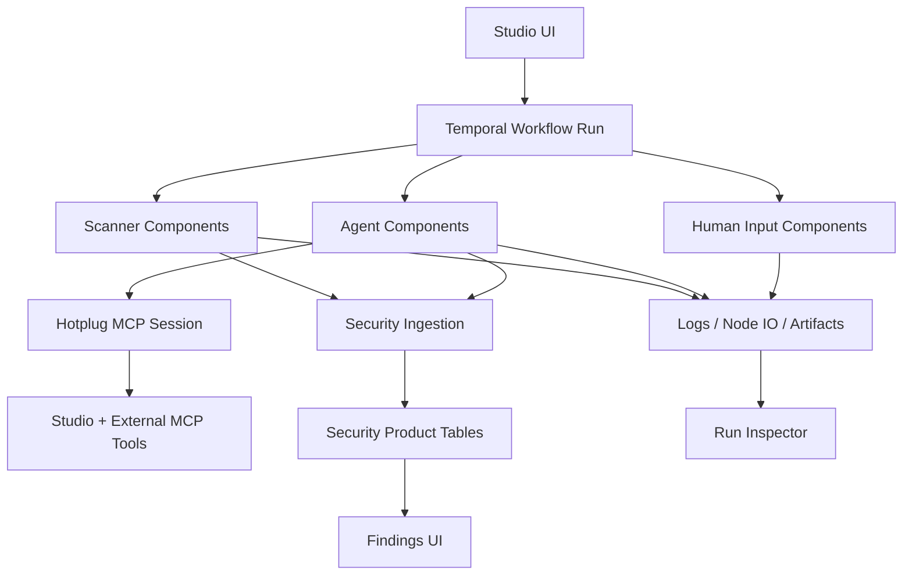
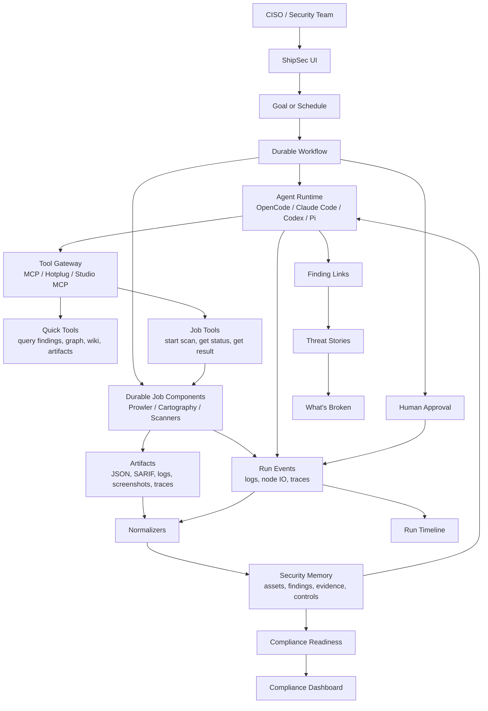

# CISO-Compatible Product Plan

## North Star

ShipSec should feel like an always-on security engineer.

The product continuously gathers evidence from code, cloud, Kubernetes, identity, external exposure, scanners, tickets, and agent investigations. It turns that evidence into durable findings, links findings into CISO-readable threat stories, derives compliance readiness, and helps users fix and verify issues.

The CISO should primarily see:

1. **What's Broken**: linked threat stories with blast radius, evidence, owner, and fix path.
2. **Compliance Readiness**: controls that pass, fail, are unknown, or are exceptioned, with evidence and blockers.
3. **Agent Work**: what the autonomous security agents did, which tools they used, what evidence they created, and what needs approval.

## Current Shape

The current codebase is already a workflow-first security automation platform.



Real pieces that exist today:

- Temporal workflow execution: `worker/src/temporal/workflows/index.ts`
- Scanner components: Prowler, Cartography, Nuclei, ASM tools, Trivy, TruffleHog, OpenGrep
- Agent components: OpenCode, Claude Code, AI SDK agent
- Tool access: Hotplug MCP sessions and Studio MCP tools
- Observability: workflow traces, workflow logs, node I/O, artifacts, agent trace events
- HITL: human input requests and manual approval components
- Security ingestion: scanner runs, assets, observations, finding instances, evidence items, control results, graph edges

The current product is not yet the final CISO product because:

- Findings are durable, but not yet the only user-facing concept.
- Linked findings are not first-class.
- Threat stories are not first-class.
- Compliance readiness does not have a real product page/API.
- Agent runs are workflow nodes, not first-class recurring security employees.
- Run evidence is split across logs, traces, artifacts, node I/O, and agent traces.

## Product Principle

Agents should get tools and room to reason.

Product code should own:

- identity
- permissions
- durable job execution
- evidence storage
- audit trail
- findings state
- approval gates
- UI projections

Agents should own:

- investigation strategy
- scratch scripts
- cross-tool correlation
- dedupe proposals
- linked threat-story proposals
- compliance explanations
- remediation drafts
- wiki updates

Long-running scanners are still workflow-owned jobs. Agents can start and inspect them through tools, but Prowler, Cartography, CodeQL, ZAP, and deep agent reviews should not be fragile blocking subprocesses inside an agent session.

## Architecture



## Story 1: Durable Findings

### What We Have

- `security_scanner_runs`
- `security_observations`
- `security_finding_instances`
- `security_evidence_items`
- `security_control_results`
- `security_finding_control_links`
- Prowler/cloud normalizer
- ASM normalizer
- agent code findings normalizer
- `shipsec.ingestion.persist`

### What We Do Not Need

- More disconnected finding schemas.
- More scanner-specific product tables.
- "AI findings" as a separate conceptual product category.
- ClickHouse as the canonical product truth.

### What We Need

One canonical durable finding model for:

- cloud findings
- code findings
- Kubernetes findings
- ASM findings
- dependency/container/secrets findings
- compliance findings
- agent-created findings

### Changes

1. Rename user-facing "AI Findings" to "Findings" or "What's Broken".
2. Rename `list_security_finding_chains` to `list_security_findings`.
3. Keep Postgres security ingestion as product truth.
4. Keep ClickHouse as analytics/cache/search.
5. Add first-class APIs:
   - `GET /security/findings`
   - `GET /security/findings/:id`
   - `GET /security/findings/:id/evidence`
   - `PATCH /security/findings/:id/status`

## Story 2: Evidence

### What We Have

- `artifacts`
- `files`
- `security_evidence_items`
- workflow logs
- node I/O
- agent trace events

### What We Do Not Need

- A second blob store.
- Giant stdout, SARIF, or JSON blobs in finding rows.
- Local agent folders as the source of truth.

### What We Need

Every finding, link, threat story, and control state must cite evidence.

Evidence can be:

- scanner JSON
- SARIF
- cloud API snapshot
- graph query result
- screenshot
- stdout/stderr
- code snippet
- PR diff
- test result
- agent scratch script output

### Changes

1. Add evidence drilldown to finding detail.
2. Require `evidence_refs` for agent-created findings and links.
3. Store artifact hashes and source event references.
4. Add Studio MCP tools:
   - `search_evidence`
   - `get_evidence`
   - `list_artifacts_for_finding`

## Story 3: Linked Findings

### What We Have

- Durable findings.
- Some graph-edge table shape.
- Agent output can include threat candidates.
- No real product object for finding-to-finding links.

### What We Do Not Need

- A deterministic universal linker.
- A giant security ontology before real data.
- Product code for every correlation strategy.

### What We Need

A first-class relationship model where agents can propose links with evidence.

Relationship examples:

- `duplicate_of`
- `same_root_cause`
- `enables`
- `contradicts`
- `same_asset`
- `same_control`
- `mitigated_by`

### Changes

Add `security_finding_links`:

```text
id
organization_id
from_finding_id
to_finding_id
relationship_type
confidence
rationale
evidence_refs
created_by_agent_run_id
review_status
created_at
updated_at
```

Add APIs and MCP tools:

- `propose_finding_link`
- `list_finding_links`
- `approve_finding_link`
- `reject_finding_link`

## Story 4: Threat Stories

### What We Have

- Product-shaped mock concepts in the findings UI.
- Durable raw findings and evidence.
- Agent code findings can include `threatCandidates`.

### What We Do Not Need

- To call raw findings "chains".
- To require every finding to become a threat story.
- To force scanners to understand business impact.

### What We Need

A CISO-facing object that explains real risk.

Example:

```text
Public admin API can reach customer data through weak authorization and an overbroad production service account.
```

### Changes

Add `security_threat_stories`:

```text
id
organization_id
title
summary
status
severity
confidence
impact
attack_path
affected_asset_ids
finding_ids
link_ids
evidence_refs
recommended_fix
created_by_agent_run_id
last_verified_at
created_at
updated_at
```

Add:

- "What's Broken" dashboard
- threat story detail page
- story proposal/review workflow
- MCP tools:
  - `list_threat_stories`
  - `get_threat_story`
  - `propose_threat_story`
  - `update_threat_story`

## Story 5: Agentic Code Review

### What We Have

- `core.ai.opencode`
- `core.ai.claude-code`
- GitHub clone/context/check-run/comment components
- `shipsec.agent-code-findings.normalize`
- workflow templates for repo and PR review

### What We Do Not Need

- To mix wiki ingestion and bug finding.
- To treat scanner output as the code-review product.
- To make code findings only PR comments.

### What We Need

Two separate flows:

1. **Code Wiki Ingestion**: architecture knowledge and service context.
2. **Agent Security Review**: real findings with evidence.

### Changes

1. Keep wiki ingestion secondary and separate.
2. Make agent security review emit strict structured output:
   - findings
   - evidence
   - affected files
   - exploit hypothesis
   - fix
   - confidence
   - linked existing finding candidates
3. Run on:
   - PRs for changed-code risk
   - main branch for full-product review
4. Persist all accepted review findings into security ingestion.

## Story 6: Cloud And Infrastructure Scans

### What We Have

- Prowler AWS/GCP/Kubernetes.
- Cartography AWS/GCP/GitHub/Kubernetes/Cloudflare.
- Cloud inventory pages.
- Cloud graph MCP tools.

### What We Do Not Need

- To make agents manually run raw scanner commands.
- To make Cartography answer every CISO question directly.
- To treat graph data as a finding without interpretation.

### What We Need

Scanners run as durable jobs. Agents inspect the results, link them, and explain impact.

### Changes

1. Keep Prowler and Cartography as workflow-owned components.
2. Add agent interpretation workflows after scans:
   - interpret cloud findings
   - link cloud findings to assets
   - identify blast radius
   - propose threat stories
3. Add schedules:
   - daily Prowler
   - daily or weekly Cartography
   - event-triggered GitHub, Kubernetes, Cloudflare refresh

## Story 7: Tool Access For Agents

### What We Have

- Hotplug MCP sessions.
- Studio MCP.
- OpenCode Hotplug CLI support.
- Run, artifact, analytics, security-ingestion, asset, connection, and cloud-graph MCP tools.

### What We Do Not Need

- Workflow components for every query.
- Static exports as the primary agent interface.
- Hardcoded product joins for every possible investigation.

### What We Need

Agents need composable tools:

- query findings
- query evidence
- query graph
- query artifacts
- query wiki
- start durable scans
- fetch scan status/results
- propose links
- propose threat stories

### Changes

1. Expand official Studio MCP around security work.
2. Prefer CLI-native access for coding agents.
3. Add durable job tools:
   - `start_prowler_scan`
   - `start_cartography_sync`
   - `get_job_status`
   - `get_job_artifacts`
4. Keep long jobs workflow-owned.

## Story 8: Unified Run Timeline

### What We Have

- workflow traces
- workflow logs
- node I/O
- artifacts
- agent trace events
- human input requests

### What We Do Not Need

- A new execution engine.
- To throw away existing observability.
- Five fragmented debug tabs as the final UX.

### What We Need

One user-facing audit timeline:

```text
Agent planned
Tool requested
Approval requested
Prowler started
Logs streamed
Artifact created
Finding created
Agent linked finding
Threat story updated
Run completed
```

### Changes

First add a read-model API:

- `GET /runs/:id/timeline`

It merges:

- trace events
- logs
- node I/O
- artifacts
- agent trace events
- human inputs
- security finding events

Later add append-only `agent_audit_events` as a dedicated ledger.

## Story 9: Compliance Readiness

### What We Have

- `security_control_mappings`
- `security_control_results`
- `security_finding_control_links`
- Prowler compliance metadata
- compliance tags in findings

### What We Do Not Need

- Manual checklist GRC.
- A Vanta clone as the first product.
- Controls that pass because a user clicked pass.

### What We Need

Compliance derived from evidence and broken things.

Control states:

- `pass`
- `fail`
- `unknown`
- `exception`
- `stale`

### Changes

Add APIs:

- `GET /compliance/frameworks`
- `GET /compliance/frameworks/:id/controls`
- `GET /compliance/controls/:id/readiness`

Each control shows:

- passing evidence
- blocking findings
- unknown evidence
- stale evidence
- exceptions
- fix plan

## Story 10: Security Wiki And Memory

### What We Have

- Some security wiki UI work.
- Agent skills.
- `wikiUpdates` in agent code findings normalization, but not durable product memory.

### What We Do Not Need

- Wiki as truth.
- Wiki ingestion as bug finding.
- A large knowledge abstraction before basic flows work.

### What We Need

Wiki as context for agents:

- service ownership
- architecture notes
- data sensitivity
- accepted risks
- false-positive history
- compliance notes
- threat model notes

### Changes

1. Keep wiki file-first.
2. Let agents read wiki during investigations.
3. Let agents propose wiki updates.
4. Require approval for important updates.
5. Link wiki pages to assets, findings, and threat stories.

## Story 11: Agent Workforce

### What We Have

- Agents as workflow nodes.
- Agent traces.
- Schedules.
- HITL.
- Tool access.

### What We Do Not Need Yet

- A complex agent society.
- Twenty personas.
- A runtime rewrite.

### What We Need

A small set of recurring security agents:

- Cloud Exposure Agent
- Code Review Agent
- IAM / Blast Radius Agent
- Compliance Agent
- Verification Agent
- Wiki Curator Agent

### Changes

Add lightweight `security_agents`:

```text
id
organization_id
name
mission
default_tools
schedule
enabled
last_run_id
status
created_at
updated_at
```

Agents still run as workflows underneath.

Add agent dashboard:

- mission
- last run
- current work
- findings created
- stories updated
- approvals waiting

## Story 12: Fix And Verification Loop

### What We Have

- GitHub app components.
- Jira issue creation.
- Slack.
- PR comments/check runs.
- Manual approvals.

### What We Do Not Need

- Fully autonomous production mutation on day one.
- Auto-close without proof.

### What We Need

Every finding and threat story has a lifecycle:

```text
open -> fix drafted -> PR/ticket opened -> merged/resolved -> retested -> verified closed
```

### Changes

1. Add remediation object or normalized metadata.
2. Link findings/stories to:
   - PR
   - Jira ticket
   - Slack thread
   - exception
   - retest run
3. Verification Agent closes issues only with evidence.

## Shipping Plan

### Phase 1: Make Findings Real

Ship:

- rename `list_security_finding_chains`
- canonical findings API
- finding detail page
- evidence drilldown
- Prowler findings persisted
- ASM findings persisted
- agent code review findings persisted

Outcome:

```text
We can show all broken things with evidence.
```

### Phase 2: Add Linked Findings

Ship:

- `security_finding_links`
- MCP tools to propose/list/approve/reject links
- agent workflow to link recent findings
- "Related Findings" UI section

Outcome:

```text
Agents can connect weak signals.
```

### Phase 3: Add Threat Stories

Ship:

- `security_threat_stories`
- What's Broken dashboard
- agent-generated story proposals
- human review for high-severity stories

Outcome:

```text
CISO sees real risks, not scanner noise.
```

### Phase 4: Compliance Readiness

Ship:

- compliance framework/control APIs
- control readiness page
- evidence/blocker mapping
- stale/unknown state
- exception support

Outcome:

```text
CISO knows what compliance controls are blocked and why.
```

### Phase 5: Unified Timeline

Ship:

- run timeline API
- timeline UI
- merge logs, artifacts, node I/O, agent traces, findings, and approvals
- evidence links from timeline

Outcome:

```text
Every agent/tool action is understandable and auditable.
```

### Phase 6: Always-On Agents

Ship:

- agent profile model
- scheduled agent runs
- agent dashboard
- recurring cloud/code/compliance/verification agents

Outcome:

```text
The product feels like autonomous security employees.
```

## First Thing To Do

Start with Phase 1, slice 1:

```text
Rename and stabilize the durable findings surface.
```

Concrete first PR:

1. Rename MCP tool `list_security_finding_chains` to `list_security_findings`.
2. Keep a deprecated alias for compatibility if needed.
3. Rename frontend `SecurityFindingChain` to `SecurityFinding`.
4. Rename `/findings` UI copy away from "AI findings/chains".
5. Add `GET /security-ingestion/findings/:id` or equivalent detail API.
6. Add evidence drilldown from current `security_evidence_items`.

This is the smallest move that turns the current code into the foundation for the CISO product.
